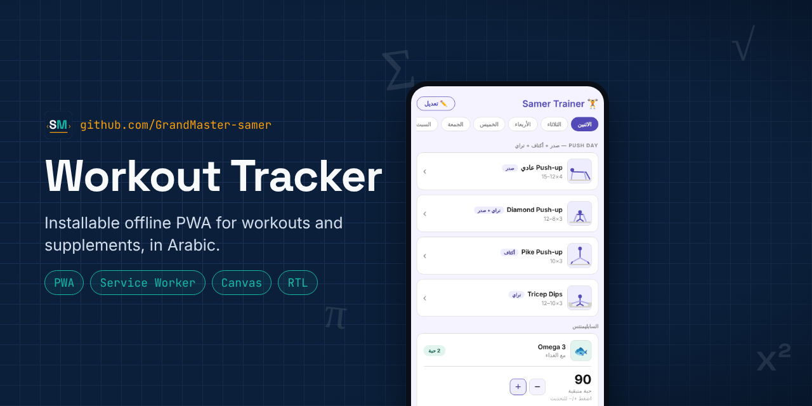
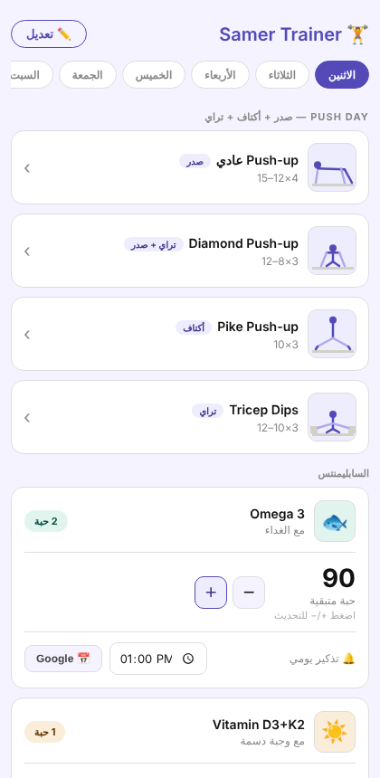

# Workout & Supplement Tracker (PWA)

A personal training app that runs in the browser and installs on a phone like a normal app. It keeps a weekly workout plan and a supplement list in one place, and it works offline after the first load. The interface is in Arabic (right-to-left).

**[▶ Try the live demo](https://grandmaster-samer.github.io/workout-tracker/)**

## Screenshots

<!-- Optional: add docs/screenshot-supplements.png and docs/screenshot-edit.png -->

## Features

- **Weekly plan:** a tab for each day of the week (push, pull, legs, full body, and rest days)
- **Exercise cards:** tap an exercise to see its sets and step-by-step instructions, with a small animated figure drawn on a canvas
- **Fully editable:** add, edit or delete exercises and supplements, and upload your own image or GIF for an exercise
- **Supplement tracker:** dose, timing and a pill counter with warnings when stock is low or finished
- **Daily reminders:** one tap opens Google Calendar with a repeating daily reminder ready to save
- **Installable and offline:** a web app manifest and a service worker let it be added to the home screen and used without internet
- **Private:** all data is saved in the browser (`localStorage`). Nothing is sent to a server.
- Dark mode follows the phone's setting

## Built with

HTML, CSS and vanilla JavaScript (canvas animations, `localStorage`, Progressive Web App manifest and service worker). No libraries or build step.

## How to use

1. Open `index.html` in a browser, or visit the live page (see below).
2. Pick a day, tap an exercise to open it, and press **تعديل** (Edit) to change the plan.
3. On Android: Chrome → ⋮ → **Add to Home Screen** to install it.

## Files

| File | Purpose |
| --- | --- |
| `index.html` | The whole app (layout, styles and logic) |
| `manifest.json` | Makes the page installable as an app |
| `sw.js` | Service worker that caches the files for offline use |
| `icon.svg`, `icon-192.png`, `icon-512.png` | App icons |

When you change any file, also change the version name in `sw.js` (for example `samer-trainer-v3`) so phones that already installed the app download the update.

## Notes

- The sample workout plan and supplement list are only examples for personal use, not medical or professional advice.
- Data stays on the device and browser where you enter it. Clearing the browser data resets the app to the sample plan.

## Live demo and GitHub Pages

**Live demo:** https://grandmaster-samer.github.io/workout-tracker/

To publish it yourself:

1. Open the repository on GitHub and go to **Settings → Pages**.
2. Under **Build and deployment**, set **Source** to **Deploy from a branch**.
3. Choose the `main` branch and the `/ (root)` folder, then click **Save**.
4. After about a minute the site is live at `https://grandmaster-samer.github.io/workout-tracker/`.
5. Copy that address into the repository's **About → Website** field so it shows at the top of the repo.

## What I learned

- Making a site installable and offline with a web app manifest and a service worker (with cache versioning).
- Drawing simple exercise animations on `<canvas>`.
- Designing a right-to-left interface.

## License

MIT. See [`LICENSE`](LICENSE).

---

Built by [Samer Monzer](https://github.com/GrandMaster-samer) · [LinkedIn](https://www.linkedin.com/in/samer-monzer-51266727a)
